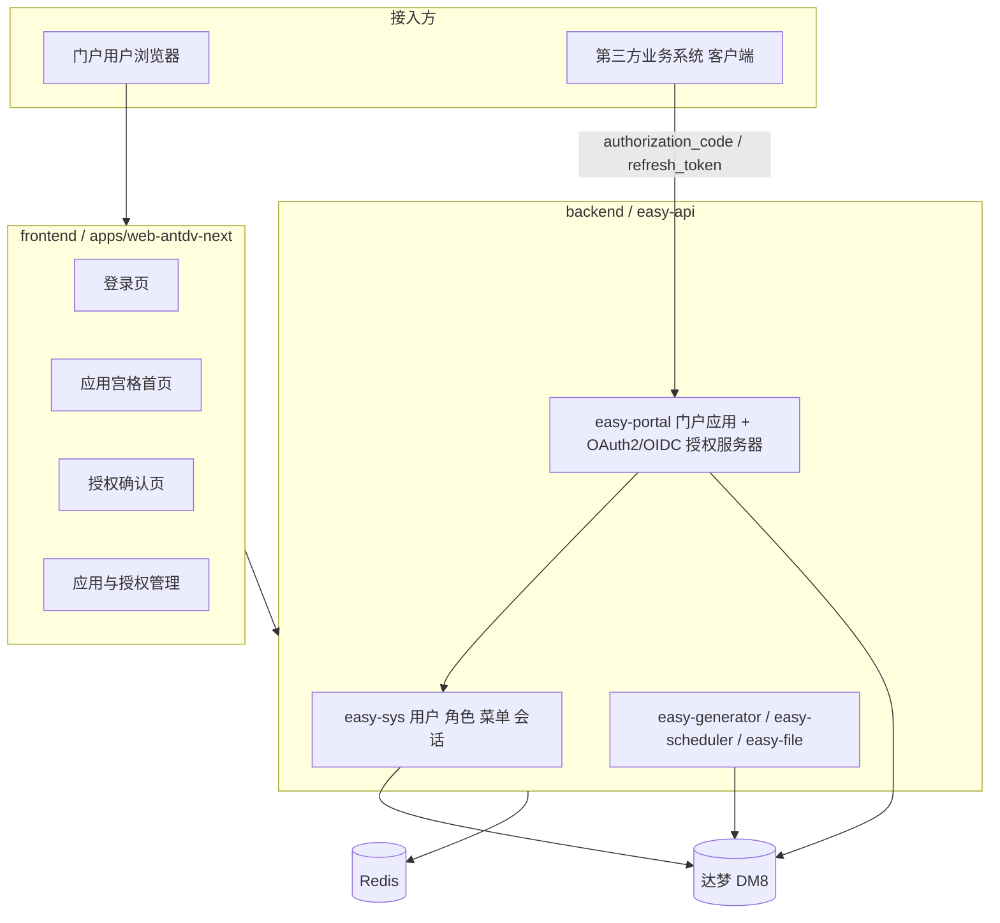
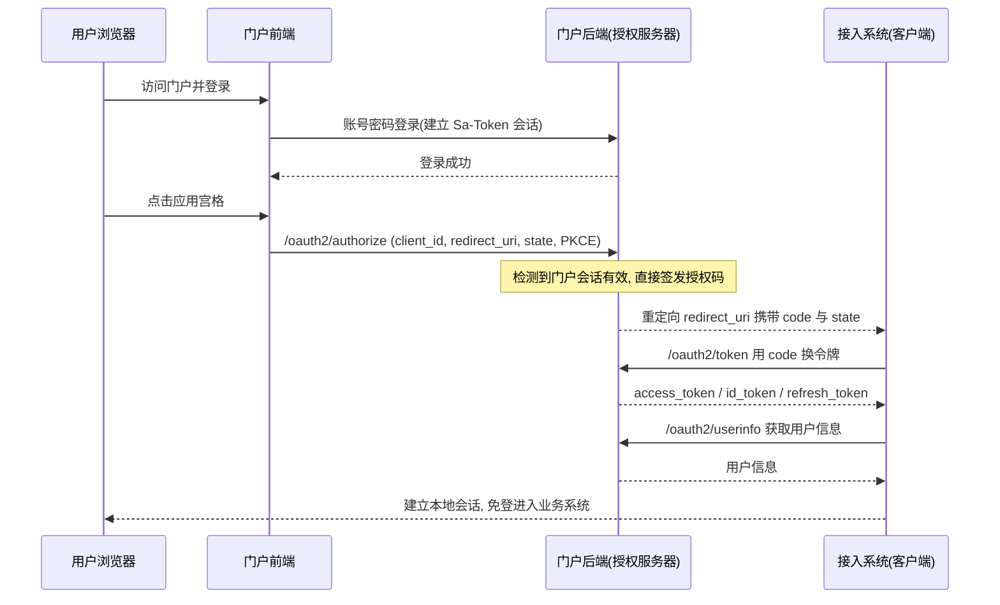

## 产品概述

统一门户平台（easy-portal）是企业多系统的统一入口与身份认证中心。用户只需登录一次门户，即可免登访问所有已接入的业务系统；同时门户作为标准单点登录授权服务端，对外提供标准协议接口，供符合标准协议的第三方系统对接集成。平台独立于现有前后端项目，单独建立工程目录开发。

## 核心功能

- **统一登录**：门户集中登录页，一次认证通行全部已接入系统
- **单点登录（SSO）**：登录门户后点击应用即可免登进入各业务系统，支持标准授权协议（OAuth2/OIDC）对接，覆盖授权码模式、客户端凭证模式与令牌刷新
- **单点登出**：门户退出后联动注销已接入系统会话
- **应用统一导航**：门户首页以应用宫格展示当前用户可访问的系统，点击直达
- **应用注册管理**：维护接入系统的名称、图标、访问地址、客户端标识与密钥、回调地址、排序、状态
- **应用授权管理**：按用户/角色/部门分配可访问的应用范围
- **标准对接能力**：提供授权端点、令牌端点、用户信息端点、发现文档与公钥端点等标准接口
- **权限与用户体系**：沿用统一的用户、角色、菜单、部门与租户管理能力
- **在线会话管理**：查看与强制下线在线用户

## 视觉与交互效果

门户整体呈现现代企业级科技感风格：登录页采用左右分栏布局，左侧为品牌视觉与渐变装饰，右侧为登录表单，配以柔和光晕与微动效；首页顶部为简洁导航栏与用户信息区，主区域为应用宫格卡片，卡片带图标、悬浮上浮与阴影动效，支持分类筛选与搜索；授权确认页以居中浮层卡片呈现待授权应用信息与权限范围，操作清晰；管理页面沿用后台经典左菜单右内容布局，表格与表单交互规范统一。整体支持亮/暗色主题与响应式适配。

## 一、技术栈选型

### 后端（backend/）

- 基础框架：Spring Boot 3.3.9 + Java 21 + Maven 多模块（沿用现有 `easy-vben` 骨架）
- 认证与会话：Sa-Token 1.40.0（现有体系，`token-name=Authorization`、在线用户、会话管理）
- 单点登录：新增 `sa-token-oauth2` 插件作为 OAuth2 授权服务器，OIDC 能力（userinfo、discovery、JWKS、ID Token）基于已有 `jjwt 0.12.6` 补齐
- 持久层：MyBatis-Plus 3.5.12 + Druid 1.2.24 + dynamic-datasource 4.3.1
- 数据库：达梦 DM8，驱动 `com.dameng:DmJdbcDriver18`
- 缓存：Redis（Sa-Token 会话、验证码、令牌存储）

### 前端（frontend/）

- 沿用现有 pnpm workspace + turborepo 单仓结构，仅保留 `apps/web-antdv-next`
- Vue 3 + Vite 8 + TypeScript + antdv-next（Ant Design Vue Next）+ Tailwind CSS 4
- Pinia（Setup Store）+ Vue Router 5 + `@vben/request`（统一 `requestClient`）

## 二、实现方案

### 1. 工程复制与解耦

将 `easy-vben` 复制为 `easy-portal/backend`、`vue-vben-admin` 复制为 `easy-portal/frontend`，**排除** `node_modules`、`dist`、`dist.zip`、`target`、`*.class`、`*.lst`、`.git`、`.DS_Store`、`tmp/` 等产物，新项目重新 `git init`。源项目零改动。

### 2. OAuth2/OIDC 授权服务器选型（关键决策）

选择 **Sa-Token + sa-token-oauth2 插件**，而非 Spring Authorization Server，理由：

- 现有系统已完整建立在 Sa-Token 之上（`StpUtil` 会话、权限注解、在线用户、`AuthService`），`sa-token-oauth2` 直接复用 Sa-Token 会话与登录态，可天然实现"门户已登录则授权免登录"（SSO 核心体验）；引入 Spring Authorization Server 需整套 Spring Security 过滤器链，与 Sa-Token 登录态双轨并存，冲突与改造面大。
- 代价与补齐：`sa-token-oauth2` 原生 OIDC 支持较弱，需自行补齐 `/.well-known/openid-configuration` 发现文档、`/oauth2/userinfo`、JWKS 与 ID Token 签发（用已有 jjwt），并自定义授权确认页（替换内置 HTML 页，改为前端 SPA 页面）。
- 覆盖范围：`authorization_code`（含 PKCE）、`refresh_token`、`client_credentials`、单点登出（`end_session`）。

### 3. 达梦 DM8 适配（仅达梦，不做双库兼容）

- 依赖层：移除 `mariadb-java-client` / `mysql-connector-java`，引入 DM8 驱动；确认 `internal` 与 `easy-common` 中无其他 MySQL 专有依赖。
- ORM 层：`easy-sys/.../config/mybatis/config/MybatisPlusConfig.java` 中 `new PaginationInnerInterceptor(DbType.MYSQL)` 改为 `DbType.DM`；确认 `TenantLineHandlerImpl` 多租户插件在 DM 下生成 SQL 的兼容性。
- 配置层：`application-{dev,prod}.yml` 的 `url`（`jdbc:dm://host:5236/SCHEMA`）、`driver-class-name`、用户名密码，`validation-query` 保留 `select 1 from dual`（达梦兼容 Oracle 语法）。
- SQL 层：`db/easy-vben.sql`、`db/quartz.sql`、`db/migration/*.sql` 全量按达梦方言重写（`AUTO_INCREMENT`→`IDENTITY`、`TEXT/INT/DATETIME` 类型映射、`LIMIT`→`OFFSET ... FETCH`、反引号→双引号且对象名默认大写、索引与注释语法、`ON DUPLICATE KEY`/`group_concat`/`date_format`/`ifnull`/`find_in_set` 等函数替换），统一放入 `db/dm/`。
- 需全量扫描 XML Mapper 与代码中的 MySQL 专有语法，逐条替换。

### 4. 模块裁剪

- 删除 `easy-cms`、`easy-workflow`、`easy-sample`（已确认被保留模块对这些包零引用，删除不破坏编译）。
- 同步清理：根 `pom.xml` 的 `<modules>`、`easy-api/pom.xml` 依赖、`easy-api` 配置中的 `beetl.*` / `cms.*` / `spring.web.resources` 的 `classpath:/themes/`、`db/cms.sql`、`db/activiti/`、`:8001` 静态资源与 CMS 页面。
- 保留 `easy-api`、`easy-common`（含 `easy-core/easy-mybatis/easy-redis/easy-swagger`）、`easy-file`、`easy-generator`、`easy-scheduler`、`easy-sys`。

### 5. 门户业务模块

新增 `easy-portal` 模块承载门户业务（与 `easy-sys` 平级），被 `easy-api` 依赖；OAuth2/OIDC 端点层放在该模块，登录会话能力复用 `easy-sys/auth`。
核心数据结构（多模块共享契约）：

- `portal_app`：`id`、`app_code`（唯一）、`app_name`、`icon`、`home_url`、`client_id`、`client_secret`（加密存储）、`redirect_uris`（白名单，逗号/JSON）、`scope`、`grant_types`、`category`、`sort`、`status`、`remark`、审计字段
- `portal_app_scope`（授权范围条目）、`portal_app_grant`（应用与用户/角色/部门的可见授权关系）
- Sa-Token OAuth2 内置客户端/授权码/令牌表（随插件建表脚本一并转换为达梦方言）

### 6. 前端裁剪与门户改造

- 删除 `apps/web-antd`、`apps/web-tdesign`、`apps/backend-mock`（已验证 `packages/*` 无反向引用），删除 `docs/`、`playground/` 及历史 `dist/`、`dist.zip`。
- 同步清理根 `package.json` 中 `build:antd`/`build:tdesign`/`build:docs`/`build:play`、`dev:*` 相关脚本与 `pnpm-workspace.yaml` 中的 `docs`/`playground` 条目、`turbo.json` 与 CI 脚本引用。
- 清理 `apps/web-antdv-next/src/views/{cms,workflow,sample}`、`packages/api/src/{cms,sample,workflow}` 及对应 i18n key、路由。
- 新增门户页面：统一登录页、应用宫格首页、OAuth2 授权确认页、应用管理、应用授权管理；对接门户后端接口，统一走 `requestClient`，i18n key 遵循 `模块.页面.元素`。

### 7. 复制/清理要点（防回归）

- 品牌重命名：父 `pom.xml` artifactId/name、`README`、`VITE_APP_TITLE`、`index.html` title、`project.url`。
- 保持 `@vben-core/*` 不依赖业务与 UI 框架的分层约束；新页面优先 Tailwind + CSS 变量，复杂部分用 Scoped SCSS。
- 复制后先跑通「后端启动 + 前端 build」，再叠加新功能，避免裁剪与新功能同时引入问题。

## 三、系统架构



## 四、OAuth2/OIDC 单点登录时序



## 五、目录结构

```
/Users/tengchong/workspaces/jundu/kaifazu/抚州二期/easy-portal/
├── backend/                                        # [NEW] 由 easy-vben 复制
│   ├── pom.xml                                     # [MODIFY] 移除 cms/workflow/sample 模块与依赖；artifactId 改为 easy-portal
│   ├── README.md                                   # [MODIFY] 更新说明、达梦初始化步骤、默认账号
│   ├── db/
│   │   ├── dm/easy-portal.sql                      # [NEW] 达梦方言基础表脚本（含 portal_app 系列表 + Sa-Token OAuth2 表）
│   │   ├── dm/quartz.sql                           # [NEW] 达梦方言定时任务表脚本
│   │   ├── easy-vben.sql                           # [MODIFY] 仅作方言参照或删除
│   │   ├── cms.sql                                 # [DELETE]
│   │   └── activiti/                               # [DELETE]
│   ├── easy-api/
│   │   ├── pom.xml                                 # [MODIFY] 删除 cms/workflow/sample 依赖，新增 easy-portal 依赖
│   │   └── src/main/resources/
│   │       ├── application.yml                     # [MODIFY] 数据源与 Druid 参数、移除 themes 静态路径
│   │       ├── application-dev.yml                 # [MODIFY] 达梦 url/driver、清理 beetl/cms/es 配置
│   │       └── application-prod.yml                # [MODIFY] 同上
│   ├── easy-common/easy-mybatis/                   # [MODIFY] 确认分页/方言与达梦兼容
│   ├── easy-sys/src/main/java/com/easy/admin/
│   │   ├── config/mybatis/config/MybatisPlusConfig.java  # [MODIFY] DbType.MYSQL 改为 DbType.DM
│   │   └── auth/                                   # [MODIFY] 复用登录/会话，供 OAuth2 授权服务器调用
│   └── easy-portal/                                # [NEW] 门户业务 + OAuth2/OIDC 授权服务器模块
│       ├── pom.xml                                 # [NEW] 依赖 easy-common 与 sa-token-oauth2
│       └── src/main/java/com/easy/admin/portal/
│           ├── oauth2/                             # [NEW] 授权端点、令牌端点、userinfo、discovery、JWKS、登出
│           ├── app/                                # [NEW] 门户应用注册与应用授权（controller/service/dao/model）
│           └── model/                              # [NEW] portal_app 等实体与 DTO
└── frontend/                                       # [NEW] 由 vue-vben-admin 复制
    ├── package.json                                # [MODIFY] 清理被删 app/docs/playground 相关脚本
    ├── pnpm-workspace.yaml                         # [MODIFY] 移除 docs/playground 条目
    ├── turbo.json                                  # [MODIFY] 同步任务范围
    ├── docs/                                       # [DELETE]
    ├── playground/                                 # [DELETE]
    ├── apps/web-antd/                              # [DELETE]
    ├── apps/web-tdesign/                           # [DELETE]
    ├── apps/backend-mock/                          # [DELETE]
    ├── apps/web-antdv-next/src/
    │   ├── views/portal/                           # [NEW] 应用宫格首页
    │   ├── views/oauth/                            # [NEW] 授权确认页与 SSO 回调页
    │   ├── views/portal/app/                       # [NEW] 应用管理、应用授权管理
    │   ├── views/auth/                             # [MODIFY] 登录页品牌与门户化改造
    │   ├── views/{cms,workflow,sample}/            # [DELETE]
    │   ├── api/request.ts                          # [MODIFY] baseURL/登录过期处理适配门户
    │   ├── router/                                 # [MODIFY] 新增门户路由与菜单
    │   └── locales/                                # [MODIFY] 新增门户 i18n 文案
    └── packages/api/src/{cms,sample,workflow}/     # [DELETE]
```

## 六、验证与验收

- 达梦 DM8 + Redis 本地可启动，`db/dm/*.sql` 可无错初始化
- 后端启动成功，登录、用户/角色/菜单等既有功能可用
- 完成一次完整 OAuth2 授权码流程（授权 → 换令牌 → 取用户信息），并支持 PKCE 与刷新令牌
- 前端门户可登录、展示应用宫格、点击跳转并免登进入演示客户端，门户登出可联动注销
- 裁剪后 `frontend` 可 `build` 成功、后端可 `package` 成功

## 设计风格

现代企业级门户风格，以「科技蓝 + 轻玻璃拟态」为核心：大面积浅色背景搭配柔和渐变装饰，卡片使用半透明磨砂质感与细腻描边，悬浮时轻微上浮并加深阴影，整体通透、克制、有秩序感。动效以 150-250ms 的缓动为主，服务于层级与反馈，不喧宾夺主。前端基于保留的 apps/web-antdv-next（antdv-next / Ant Design Vue Next）实现，样式优先使用 Tailwind 原子类与 CSS 变量主题化，复杂区域使用 Scoped SCSS。

## 页面规划（共 5 页）

### 1. 统一登录页

- 顶部：品牌标识与平台名称，右侧语言与主题切换
- 左栏：品牌视觉区，渐变光晕背景、产品标语、特性要点与装饰图形
- 右栏：登录表单卡片，含账号、密码、图形验证码、记住我与登录按钮
- 底部：版权信息与备案/帮助链接

### 2. 门户首页（应用宫格）

- 顶部导航：平台名称、全局搜索、消息提醒、用户头像下拉（个人中心/退出）
- 欢迎区：当前用户问候语、待办与在线时长等关键指标卡片
- 应用区：按分类分组的应用宫格卡片，含图标、名称、描述与悬浮上浮动效，支持搜索与分类切换
- 快捷区：最近访问应用与常用功能快捷入口

### 3. OAuth2 授权确认页

- 头部：接入应用图标与应用名称，说明申请授权
- 授权范围：以勾选列表展示申请的数据权限范围与说明
- 身份提示：当前登录账号与切换账号入口
- 操作区：同意授权 / 拒绝 按钮，明确二次确认提示

### 4. 应用管理页

- 顶部：页面标题与「新增应用」主按钮
- 筛选区：按应用名称、分类、状态快速检索
- 数据表格：应用图标、名称、编码、客户端标识、访问地址、排序、状态与操作列
- 表单弹窗：维护名称、图标、访问地址、客户端密钥、回调地址白名单、授权范围与排序

### 5. 应用授权管理页

- 顶部：目标应用信息卡片与授权统计
- 左侧：用户/角色/部门授权对象树形选择
- 右侧：已授权对象列表与授权范围展示
- 操作区：批量授权、按对象回收授权、保存并即时生效

## 响应式

桌面端为主：应用宫格 4-6 列自适应，管理页左菜单右内容；宽度小于 768px 时宫格降为 2 列、侧边菜单收起为抽屉、表格改为卡片列表。

## Agent Extensions

### Skill

- **easy-vben-fullstack**
- Purpose: 用于生成门户应用管理（应用注册、应用授权）等标准化 CRUD 模块，产出后端 Controller/Service/ServiceImpl/Entity/Mapper/DDL 与前端列表页、表单弹窗、API 函数、路由与 i18n，并完成前后端接口对接
- Expected outcome: 形成符合现有 easy-vben 全栈规范的完整可运行模块，减少手写样板代码与规范偏差

- **design-to-code-workflows**
- Purpose: 依据门户页面布局规格（应用宫格首页、OAuth2 授权确认页、应用管理页等）生成无障碍友好的 Vue 组件骨架，包含语义化结构与 ARIA 属性
- Expected outcome: 产出可直接接入 web-antdv-next 工程的页面组件初稿，并通过无障碍基础校验（键盘可达、色彩对比度达标）

### SubAgent

- **code-explorer**
- Purpose: 在复制后的后端工程中全量定位对 cms/workflow/sample 的残留引用，以及所有 MySQL 专有语法与函数（limit、group_concat、date_format、ifnull、find_in_set、ON DUPLICATE KEY、反引号等）在 XML Mapper 与代码中的分布，并核对前端被删应用的反向引用
- Expected outcome: 输出精确到文件与行号的清理清单与 SQL 改写清单，确保模块裁剪与达梦方言改造无遗漏且不破坏编译